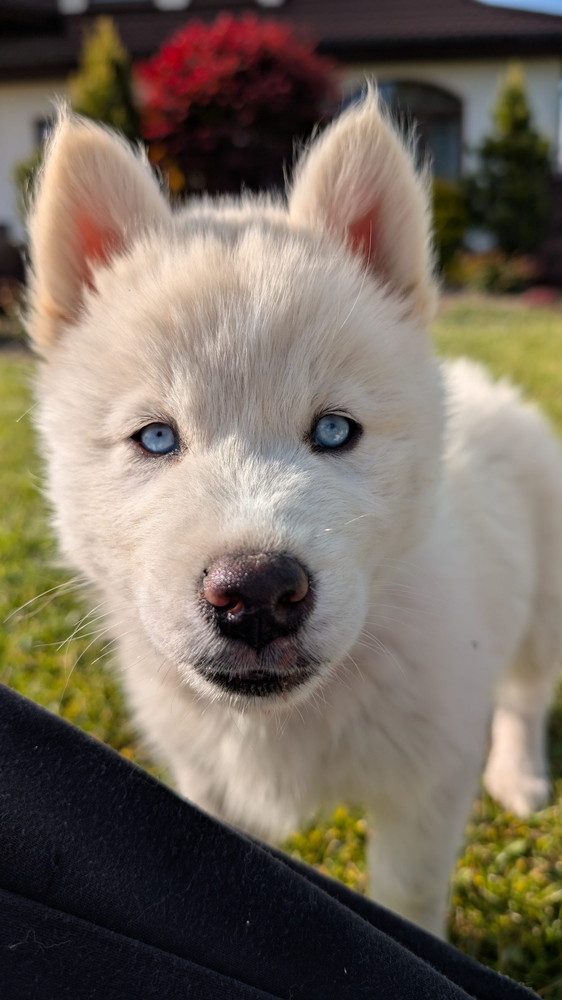

# Syberis

> A production website for a Siberian Husky kennel, built by Studio 221.

**Live website:** [syberis.221studio.pl](https://syberis.221studio.pl/)

Syberis brings the kennel's story, dogs, current and past litters, photo gallery, and contact details together in one place. The experience pairs editorial photography and motion with a direct path to puppy information and contact, and is designed to work on phones as well as desktop.



## What the project demonstrates

- A multi-page, Polish-language site built with Next.js App Router.
- Reusable pages driven by a central kennel and litter data module.
- Interactive litter browsing, parent profiles, and a Three.js photo gallery.
- GSAP scroll and page-transition effects, with mobile-specific behavior.
- Contact links for phone, email, maps, and the kennel's social channels.
- A standalone production build suitable for container deployment.

## Pages

| Route             | Purpose                                            |
| ----------------- | -------------------------------------------------- |
| `/`               | Brand introduction and featured content            |
| `/mioty`          | Current and completed litters                      |
| `/mioty/[letter]` | Litter details, puppies, parents, and availability |
| `/rodzice`        | Profiles of the kennel's dogs                      |
| `/galeria`        | Interactive photo gallery                          |
| `/kontakt`        | Contact options and location                       |

## Tech stack

- Next.js 16.4, React 19, JavaScript
- GSAP, Lenis, Three.js
- CSS, with locally hosted fonts and photography
- Vitest, ESLint, Prettier, GitHub Actions

## Run locally

Requirements: Node.js 20.9 or newer and npm.

```bash
git clone https://github.com/221Studios/Syberis.git syberis
cd syberis
npm ci
npm run dev
```

Open <http://localhost:3000>. The site does not require environment variables for local development.

## Project commands

```bash
npm run dev          # local development server
npm run build        # production build
npm start            # serve the production build
npm test             # unit tests
npm run lint         # ESLint
npm run format:check # Prettier check
npm run format       # format supported source and documentation files
```

## Architecture

The app uses the Next.js App Router. Route modules compose page-level experiences from focused UI modules. Kennel, dog, litter, and puppy content lives in `src/data/kennel.js`; contact link formatting lives in `src/lib/contact.js`. This keeps content changes separate from page rendering and gives data helpers a small, directly testable interface.

See [the architecture notes](docs/architecture.md) for the route map, module responsibilities, and deployment shape.
Contribution and commit conventions are in [CONTRIBUTING.md](CONTRIBUTING.md).

## Deployment

`next.config.mjs` enables Next.js standalone output. Pull requests run the quality checks; pushes to `main` deploy automatically after those checks pass. The workflow syncs the source to the production host over SSH, then runs the restricted `/usr/local/sbin/syberis-deploy` command to rebuild and restart the Docker container.

The GitHub repository needs the `DEPLOY_SSH_KEY` Actions secret and these Actions variables: `DEPLOY_HOST`, `DEPLOY_PORT`, `DEPLOY_USER`, `DEPLOY_PATH`, and `DEPLOY_KNOWN_HOSTS`. Run `scripts/setup-deploy-host.sh` once on the server to install the root-owned deployment command and its limited sudo rule. `scripts/deploy-221studio.sh` runs the same deployment command manually on the host.

## Credits and project context

This repository presents a Studio 221 project. The live site and its content belong to the Syberis kennel. See the [live website](https://syberis.221studio.pl/) for the current public experience.
