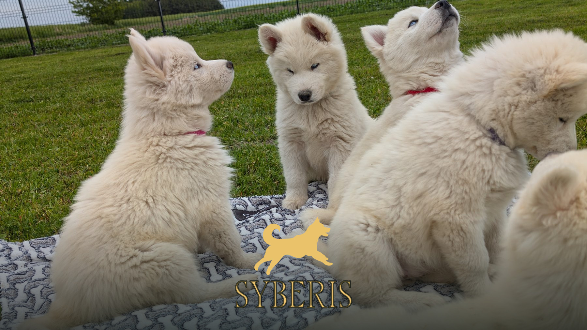
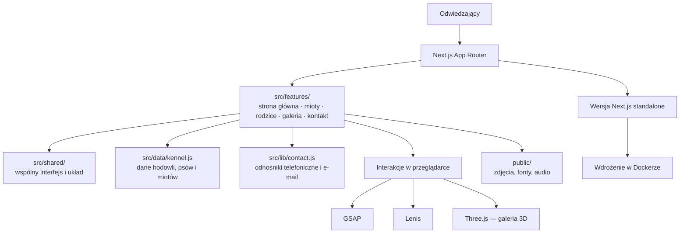

# Syberis


**Demo na żywo:** [syberis.221studio.pl](https://syberis.221studio.pl/)

Syberis to wielostronicowa strona hodowli Siberian Husky, która łączy historię hodowli, profile psów, informacje o miotach i kontakt w jednym miejscu. Pomaga zainteresowanym poznać psy i sprawdzić informacje o szczeniętach.



## 📑 Spis treści

- [O projekcie](#-o-projekcie)
- [Główne funkcje](#-główne-funkcje)
- [Technologie](#-technologie)
- [Instalacja i uruchomienie](#️-instalacja-i-uruchomienie)
- [Użycie](#-użycie)
- [Architektura](#-architektura)
- [Testowanie i jakość kodu](#-testowanie-i-jakość-kodu)
- [CI/CD i wdrożenie](#-cicd-i-wdrożenie)
- [Współtworzenie](#-współtworzenie)
- [Licencja](#-licencja)

## 🚀 O projekcie

To responsywna, polskojęzyczna strona prezentująca hodowlę Syberis. Zawiera informacje o psach, aktualnych i wcześniejszych miotach, zdjęcia oraz dane kontaktowe. Treści hodowli są oddzielone od widoków i przechowywane w centralnym module danych.

## ✨ Główne funkcje

- [x] **Przegląd miotów:** lista aktualnych i zakończonych miotów z informacjami o dostępności szczeniąt.
- [x] **Profile psów:** zdjęcia, informacje i powiązania rodziców z miotami.
- [x] **Szczegóły miotu:** profile szczeniąt, rodzice i statusy dostępności.
- [x] **Galeria 3D:** interaktywna galeria zdjęć z obsługą ruchu wskaźnika i gestów dotykowych.
- [x] **Animacje i przejścia:** efekty przewijania oraz przejścia między podstronami.
- [x] **Kontakt:** bezpośrednie odnośniki do telefonu, poczty, mapy i mediów społecznościowych.
- [x] **Układ mobilny:** dostosowane widoki i interakcje na telefonach oraz komputerach.

## 🛠 Technologie

- **Framework i biblioteka UI:** Next.js 16, React 19
- **Język:** JavaScript
- **Animacje i przewijanie:** GSAP, `@gsap/react`, Lenis
- **Grafika 3D:** Three.js
- **Style:** CSS
- **Testy:** Vitest
- **Jakość kodu:** ESLint, Prettier
- **CI/CD:** GitHub Actions, Docker

## ⚙️ Instalacja i uruchomienie

### Wymagania wstępne

- Node.js 20.9 lub nowszy
- npm
- Git

### Kroki instalacji

1. Sklonuj repozytorium:

   ```bash
   git clone https://github.com/221Studios/Syberis.git syberis
   cd syberis
   ```

2. Zainstaluj zależności:

   ```bash
   npm ci
   ```

3. Uruchom serwer deweloperski:

   ```bash
   npm run dev
   ```

4. Otwórz [http://localhost:3000](http://localhost:3000).

Lokalne uruchomienie nie wymaga zmiennych środowiskowych.

## 📖 Użycie

Po uruchomieniu aplikacji można przejść do głównych sekcji strony:

| Ścieżka           | Zawartość                                         |
| ----------------- | ------------------------------------------------- |
| `/`               | Informacje o hodowli i wyróżnione treści          |
| `/mioty`          | Aktualne i zakończone mioty                       |
| `/mioty/[letter]` | Szczegóły miotu, szczenięta, rodzice i dostępność |
| `/rodzice`        | Profile psów hodowlanych                          |
| `/galeria`        | Interaktywna galeria zdjęć                        |
| `/kontakt`        | Formy kontaktu i lokalizacja                      |

Przydatne polecenia:

```bash
npm run dev          # serwer deweloperski
npm run build        # kompilacja produkcyjna
npm start            # uruchomienie wersji produkcyjnej
npm test             # testy jednostkowe
npm run lint         # ESLint
npm run format:check # kontrola formatowania
npm run format       # formatowanie plików projektu
```

## 🏗 Architektura

Aplikacja korzysta z Next.js App Router. Moduły routingu odpowiadają za adresy i metadane, katalog `src/features/` zawiera funkcje poszczególnych części strony, a `src/shared/` — współdzielone elementy interfejsu i układu. Dane hodowli znajdują się w `src/data/kennel.js`, a formatowanie odnośników kontaktowych w `src/lib/contact.js`.



Szczegółowy opis modułów, routingu i wdrożenia znajduje się w [dokumentacji architektury](docs/architecture.md).

## 🧪 Testowanie i jakość kodu

Vitest sprawdza kluczową logikę danych hodowli oraz tworzenie odnośników kontaktowych. GitHub Actions uruchamia instalację zależności, audyt npm, kontrolę formatowania, ESLint, testy i kompilację przy każdym pull requeście oraz pushu do `main`.

```bash
npm test
npm run format:check
npm run lint
npm run build
```

## 🚀 CI/CD i wdrożenie

Po przejściu kontroli push do `main` uruchamia wdrożenie produkcyjne. Workflow synchronizuje pliki z serwerem przez SSH, a następnie wywołuje ograniczone polecenie `/usr/local/sbin/syberis-deploy`, które buduje i restartuje kontener Dockera.

Do wdrożenia repozytorium GitHub wymaga sekretu `DEPLOY_SSH_KEY` oraz zmiennych Actions: `DEPLOY_HOST`, `DEPLOY_PORT`, `DEPLOY_USER`, `DEPLOY_PATH` i `DEPLOY_KNOWN_HOSTS`. Skrypt `scripts/setup-deploy-host.sh` instaluje na serwerze polecenie wdrożeniowe i ograniczoną regułę sudo. `scripts/deploy-221studio.sh` pozwala uruchomić wdrożenie ręcznie na serwerze.

## 🤝 Współtworzenie

Zasady współtworzenia i format commitów opisuje plik [CONTRIBUTING.md](CONTRIBUTING.md).

## 📄 Licencja

Repozytorium nie zawiera obecnie pliku licencji. Prawa do strony i jej treści należą do hodowli Syberis; projekt powstał w Studio 221. Szczegóły można znaleźć na [stronie hodowli](https://syberis.221studio.pl/).
